# Architecture

## Actual frontend structure

The application lives in navapack-frontend, which has its own Git repository and package.json. No backend code is present.

src/main.tsx mounts React StrictMode and BrowserRouter. src/App.tsx composes AuthProvider → SalesOrdersProvider → ModelsProvider → CommercialProvider → QualityProvider → InventoryProvider → CostingProvider → QuotationsProvider → ConsumablesProvider → JobCardsProvider → InvoicesProvider. RequireAuth checks the in-memory user; AppShell hosts nested routes and role-filtered navigation. Navigation visibility is not server authorization.

Routes: / (Dashboard), /sales-orders and /sales-orders/new, /job-cards and /job-cards/:id, /stock, /raw-materials, /recycling, /costing, /track-trace, /masters and /login. The new-order route opens the modal on the list page. Placeholder.tsx remains in source but is not wired to these module routes.

Shared UI lives in components/ui; branding/login elements in components/login; shell/navigation in components/layout. Tailwind configuration and src/index.css supply styling. Branding is public/assets/Nava-logo.png. Vite maps @ to src and uses relative asset base paths.

## State and data flow

Sales order form -> validation/build helpers in lib/salesOrders.ts -> SalesOrdersContext -> list and Stock SalesOrderDemand.
The form selects finished-goods variant IDs and reads InventoryContext balances. Creating an order does not write movements.
Demand reads each open line against current finished-goods stock independently; it is not an allocation engine.

Finished-goods reference -> lib/finishedGoodsData.ts -> InventoryContext movements -> Stock balances, movement history and monthly reports.
Raw-material reference plus legacy demo granules -> lib/rawMaterialData.ts -> separate InventoryContext movements -> Virgin Material, Recycled Granules and Ink views.

Both Context stores survive navigation and reset on refresh. Customer Masters and Sales Order customer suggestions share CommercialContext; item/supplier/department/user Masters remain page-local and staff suggestions retain existing mock data. JobCardsContext lazily loads the existing list/detail APIs with mock fallback, normalizes legacy records and keeps manufacturing mutations in frontend state across routes. The existing stage-requirement PATCH remains available with explicit fallback; approval/issue/stage actions remain local, and linked stock confirmations now post to InventoryContext without new endpoints. Recycling, Costing and Track & Trace use Axios with mock fallbacks. Dashboard retains its existing operations demo metrics; quotation metrics additionally derive from live session QuotationsContext records.

Types are in src/types/index.ts and domain data/helper files. Balance functions and variant matching live alongside inventory types. Generated reference files contain workbook-derived records; extraction scripts require Python/openpyxl. Detailed FG interpretation is maintained in finished-goods-reference.md.

## Authentication

AuthContext keeps the user in memory and stores real-login access/refresh tokens in localStorage; it does not restore a user session on refresh or refresh tokens automatically. Login supports mock credentials under the conditions documented in README.md. Axios attaches a stored access/legacy token. Its 401 handler removes the legacy token and redirects outside login; complete token cleanup is currently in logout.

## Future Backend Integration

Replace Context seed loading/create/add methods with API adapters while preserving variant IDs, units and unknown balances. Connect master state to order selection and production data to inventory.

Existing client calls in lib/api.ts and module pages expect authentication, job-card reads/stage writes, recycling reads, costing/rate reads and writes, and trace lookup. They are not documented as implemented server contracts. Verify response shapes and error handling against the eventual backend; failed stage/rate writes currently retain local changes.

Define authoritative inventory posting, reservations, statuses and permissions before integrating production or dispatch. See BACKEND_TODO.md.

## Sales fulfillment

`/sales-orders/:id` connects existing stores. InventoryContext owns finished receipts, reservations and dispatch/reversal transactions. JobCardsContext posts validated QC receipts; SalesOrdersContext owns stable order/job links; InvoicesContext owns snapshots without moving stock. Pure helpers live in fulfillment.ts, salesJob.ts and invoices.ts. See [workflow limitations](sales-fulfillment.md).

## Custom costing and routing

ModelsContext and CostingContext provide shared, session-only versioned model/estimate state upstream of JobCardsContext. Existing order/job/inventory stores remain connected. ModelManager replaces page-local model editing; other master categories retain their previous behavior. CustomCosting extends the existing Costing page while preserving legacy record/rate calls. Dynamic routing uses domain helpers and approved snapshots rather than a fixed component route. See [implementation and boundaries](custom-costing-routing.md).

## Parent/item workflow — 13 October 2026

JobCardsContext continues to own all Job Cards. New headers embed manufacturing items using the existing workflow fields; `parentJobCards.ts` derives scope, status and chronological activity. Mutation adapters target an item and republish its parent. Atomic parent approval validates every manufacturing line first. Views resolve stable work-item IDs under one parent; inventory receipt references carry both parent and item IDs. Legacy single-product records keep their existing paths and API behavior. No second production or inventory store was introduced. See sales-fulfillment.md for the partial implementation boundary.

## Quality Control & Quality Assurance Module

QualityProvider sits under Auth/Models and above Inventory/JobCards. It owns versioned templates, inspections, responses, reviews, releases, NC actions and history in session state. InventoryProvider consults synchronous QC state for raw availability, manufactured Stock IN and held-batch dispatch; inventory remains the stock owner. JobCardsProvider partitions completed stage output into stable inspection lots and enforces item-specific/mandatory-routing QC. ModelsContext provides shared machine identities. Existing Sales Orders, costing/model snapshots, invoices, recycling data and ledgers are reused. QC Inspector/Supervisor use the same login and a dedicated dashboard/navigation; other roles retain their screens.

Master workflow (confirmed target, with frontend boundaries documented in [quality.md](quality.md)):

```mermaid
flowchart LR
  PROS[Customer Prospect / existing customer] --> QUOTE[Quotation / Proforma Invoice]
  QUOTE --> IA[Internal approval]
  IA --> CA[Customer acceptance of exact revision]
  CA --> SO[Sales Order]
  DIRECT[Direct customer order] --> SO
  SO --> JC[Parent Job Card / manufacturing items]
  IP[Internal production request: pending frontend phase] --> JC
  JC --> PM[Production Manager approval / approved routing]
  RM[Physical raw receipt] --> RQC[Raw material QC inspection / quality release]
  RQC --> MI[Store material issue]
  PM --> MI
  MI --> PROD[Sequential production / mandatory item QC checkpoints]
  PROD --> QC[Exact item / run / batch QC inspection]
  QC --> QR[Independent quality review / release]
  QR --> FA[Separate Supervisor / Manager stock authorization]
  FA --> IN[Inventory-owned Finished Goods Stock IN]
  IN --> DSP[Confirmed dispatch / Stock OUT]
  QC --> NC[Hold / non-conformance / corrective action / reinspection]
  NC --> QC
```

Future Django architecture adds a dedicated `quality` app for templates/versions, inspections, reviews, release decisions, NCs/actions, attachments and audit. `production` owns routing/run/stage output; `inventory` owns receipts/batches/Stock IN/OUT and quality availability; `masters` owns source identities/users; `accounts` owns costing/invoices; `reports` owns scoped projections; `recycling` owns authorized waste disposition. QC never moves ledger ownership into quality. [Canonical backend models, APIs and transaction boundaries](quality.md) are proposed, not implemented endpoints/schema.

## Quotations / commercial source integration

CommercialContext owns the shared customer/prospect/company/bank/terms state; existing Customer Masters and order suggestions reuse it. QuotationsContext lives below CostingProvider and above JobCardsProvider, consuming approved estimate/model/order references. The existing costing engine accepts explicit quotation origins before an order exists; quoted approved financial snapshots acquire real order-line bindings on conversion. No second order/inventory/pricing service or fake Sales Order is created.

`commercialPricing.ts` provides explicit inclusive/exclusive tax/discount/rounding for quotation snapshots and converted orders/invoices. Direct order paths retain their previous behavior. Public quotation projections whitelist customer-facing fields. The future/planned Django sales app owns quotation families/revisions/lines/reviews/customer responses/terms snapshots and atomic idempotent order conversion, reusing masters/costing/company/order entities. See [canonical data/API/lifecycle/transaction specification](quotations.md). No new network endpoints or backend code were introduced.
