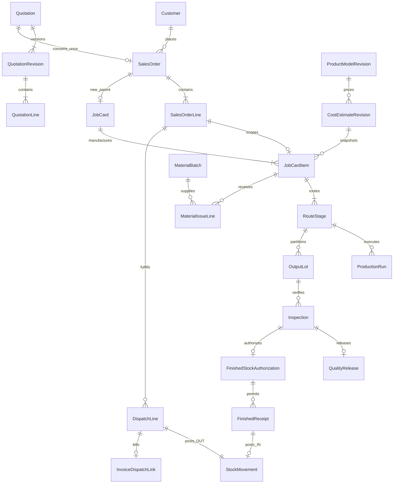

# Django / PostgreSQL database blueprint

15 October 2026. Proposed design only: no models, migrations or server code generated. Derived from source, not invented SOP contents. Source field definitions and optionality: [frontend models](FRONTEND_DATA_MODELS.md). HTTP consumers: [API](API_CONTRACT_BLUEPRINT.md). Existing [QC](../quality.md) and [quotation](../quotations.md) documents contain deeper domain proposals; use the normalized ownership here to avoid duplicate masters and ledgers.

## Shared conventions for every model below

UUID primary key; created_at/updated_at and created_by/updated_by server FKs; monotonic version for mutable aggregates. Immutable transactions use posted_at/posted_by and reversal/supersession links rather than overwrites. Human document numbers have company/series uniqueness allocated transactionally, never max(client array)+1. PostgreSQL Decimal-backed NUMERIC quantities, currency amount/unit price and FX at explicitly agreed precision (provisional quantities 6 decimals, amounts 2, prices/FX higher precision; confirm before migration). Currency and Unit reference governed values; dimension/category compatibility separate from display aliases. Never universally convert Each/Both/pcs/ctn/kg/Litres.

All important FKs protected from deletion after posting; deactivate masters. Per-model constraints and indexes below supplement primary-key/FK indexes. AuditEvent records aggregate type/id, action, actor, before/after state or safe diff, reason, request ID, source versions and time; retain sensitive financial access restrictions. Actor names may be snapshotted for history but never replace identity. Snapshot JSON is appropriate for immutable document/model/template/calculation evidence; normalized source relations and queryable amounts remain authoritative. No executable Python is prescribed here.

## Model catalog

Each row gives app/models, purpose/fields and relationships, constraints/indexes/lifecycle, source and unresolved decisions. Shared audit/version conventions apply to **every** row.

| App / model(s) | Purpose, fields and relationships | Constraints / indexes / lifecycle | Source and unresolved assumptions |
|---|---|---|---|
| identity.User, Role, Permission, Membership | Name,email,department FK,active; role capabilities separate from demo Role string | Unique normalized email; active/department/role lookup. Account lifecycle explicit; never trust Masters free text | AuthContext/types/MasterTable; SOP role mapping and multi-role/company scope pending |
| core.AuditEvent, IdempotencyRecord | Aggregate ID/type/action/actor/time/diff/reason; command key/request hash/status/result | Audit index aggregate,time and actor,time; unique company/action/key; immutable audit, successful result reusable | Current activity arrays/request IDs; retention/key TTL/privacy pending |
| core.DocumentSeries | Company,document kind,prefix,next counter,period | Unique company/kind/period; row lock increment; no recycled numbers after posting | SO/QT/JC/DSP local numbering; numbering policy pending |
| masters.Customer, Supplier, Department | Customer contacts/type/addresses/TIN/prospect; Supplier name/contact/materialSupplied snapshot; Department manager FK | Search/name/type/active; do not unique customer name alone; relationships protected | CommercialContext/MastersPage; duplicate policy, real supplier details pending |
| sales.Prospect | Customer-like party fields,linked_customer FK,created_by | Linked customer explicit and idempotent; contact search; no automatic fuzzy merge | addProspect/promoteProspect; customer creation authority pending |
| masters.Unit, Product, ProductVariant | Product group + variant category,size,brand,packing,pieces,customer FK(optional),source row/sheet/customer/unit/data notes | Unique import-source key; retain repeated variants pending reconciliation; category/customer/unit/search indexes; positive optional pieces | FinishedGood + generic Item conflict; consolidate identity mapping before imports |
| masters.Material, Consumable | Material code/name/family/raw category,unit; Consumable imported/local category,min level,active | Unique governed code; family/category/unit lookup; no guessed new material codes; separate inventory scope | RawMaterial/Consumable; code source absent, grade identities retained |
| masters.Machine, Area | Machine name/type/department/active; cleaning Area | Unique governed identity; type/department/active indexes; extend machine types only when confirmed | ModelsContext Machine/quality area; equipment maintenance not implemented |
| masters.ProductModel, ProductModelRevision | Stable family + revision,name/default unit/specifications/dimensions,recipe mode,batch qty/unit,waste,overheads,defaults | Unique model,revision; latest index; referenced revisions immutable | Model/ModelsProvider; allow incomplete draft recipe vs activation validation |
| masters.ModelRecipeLine, ModelProcessCost, ModelRouteStage | Revision FK; exact material qty/unit/percentage/currency/price/FX/cost group; process basis/rate/qty; stage sequence/name/dept/unit/machine/checkpoints | Distinct material per recipe; unique stage sequence; positive validated percentages/quantity. Revision snapshots frozen on use | RecipeFields/ProcessFields/RoutingFields; versioning and approval of defaults pending |
| commercial.CompanySettingsRevision, BankAccount, TermsTemplate | Legal/trading/contact/logo/TIN/signatory/currency/tax/validity,bank rows,terms name/clauses/advance/credit/tolerance | Unique company/revision and terms name/version; immutable document snapshot; admin audit | CommercialContext/CompanySettings; missing reference identities/bank details |
| sales.Quotation, QuotationRevision | Stable family/generation key/number; revision,parent revision,status,date/validity/delivery,currency/tax mode/rate/discount,party/company/terms snapshots,representative,creator | Unique family,revision and company document number; unique generation key when present; latest/status/date/customer indexes; retain superseded | quotations.ts/QuotationsContext; source validation at every approval/send/convert |
| sales.QuotationLine | Revision FK,logical line UUID,type,product/model revision FK,description/group/spec,qty/unit/price,estimate revision FK,LED snapshot | Unique revision,logical line; source-kind checks; monetary totals server computed; approved immutable | QuotationLine/quotedCostPrice; latest model drift policy currently blocks conversion |
| sales.QuotationApproval, CustomerResponse, QuotationEvent, EmailDraft | Exact revision FK,actor/decision/totals/rounding; response type/date/respondent/evidence; email recipient/cc/subject/body/manual attachment/status | Approval/history append-only; revision,time indexes. Email draft is never delivered status | review/response/emailDraft; maker-checker policy and evidence retention pending |
| sales.SalesOrder, SalesOrderLine | Header customer/date/marketing/type/requisition/currency/tax/status/frozen totals/commercial snapshots; lines exact product/model/costing/fulfillment source/qty/unit/price/delivery/LED | Unique quotation-family origin for converted SO; unique company/order number; order/date/customer/status indexes; stable line identity | buildSalesOrder/createSalesOrder; standalone order approval/amendment/cancel missing |
| costing.CostEstimate, CostEstimateRevision | Stable estimate series + immutable revision/source-kind/source IDs,model revision,quantity/unit,recipe/process/charges/waste/FX/LED config and calculated snapshot,status/approval/customer response/generated date | Unique series,revision; reference exactly quotation line OR actual order line; source/status/model indexes; approved/generated/used revision frozen | CostingInput/CostEstimate; preserve quotation-origin source on adoption |
| costing.EstimateOrderLink, EstimateMaterialLine, EstimateProcessLine | Adopted actual order/line binding; cost breakdown children with material/currency/FX/rate/basis/qty | Unique estimate/order-line; exact quantities/model/unit; price history immutable | bindQuotationOrder/estimateMatchesOrder/materialRequirements |
| costing.ExchangeRate, PricingPolicyRevision, StockPriceRevision | Explicit currency pair/rate/effective source; governed policy versions; product/model/batch/quantity/conversion/LED/VAT/estimated+evidenced actual COP | Positive FX; unique pair/effective source/version; product,batch,revision uniqueness; no historical reprice | led/stockIntelligence/legacy FX; LED base, purchase net/VAT basis and currency conflict pending |
| inventory.ProductConversionRevision, StockPolicy | Exact variant+optional model+unit+effective date/version,kg per carton,pieces; min/critical/reorder/target/window/pending replenishment | Unique exact identity/version; effective lookup; positive ratio; threshold ordering check. Store snapshot on transaction | quantitySnapshot/saveConversion/saveThreshold; effective-date governance pending |
| inventory.Warehouse, Location | Warehouse/location names/active/company; destination/source for ledger | Unique warehouse/location code; protect posted refs | Needed for inventory ownership but no UI; single initial location choice requires client approval, no invented warehouse endpoint |
| inventory.ImportBatch, OpeningBalanceEvidence | Source filename/sheet/row/revision,exact entity/unit/date,nullable source opening/closing,notes,reconciliation state | Unique import provenance; raw source hash/review actor; never coerce null to 0. Known openings post distinct ledger event | Reference files/extraction scripts/finished-goods-reference; originals absent |
| inventory.MaterialReceipt, MaterialBatch, FinishedBatch | Receipt source/material/supplier/date/batch/qty/unit/status; FG lot/source output/variant/QC authorization | Unique external/source reference within scope; exact stock owner and unit; supplier+batch lookup; no invented seed supplier | raw movement missing FKs, JobCard.productionBatches vs QCSubject; batch provenance pending |
| inventory.StockTransaction, StockMovement | Header command key,purpose/date/ref/reason/actor/source; immutable lines scope,entity,location,batch,direction,positive quantity,unit,conversion snapshot,reversal_of | Exactly one FG/material/consumable owner; positive qty; unique source posting key/reversal; entity/location/batch/date,id indexes; paired transfers atomic | FG/raw/consumable arrays; posted OPENING/IN/OUT and reversal, no editable balances |
| inventory.StockBalance (optional projection) | Entity/location/batch/unit cached posted balance/version | Unique identity+location+batch+unit; lock for stock checks; reconstructable from ledger; reconciliation job flags drift | physical/rawMaterialBalance; use one consistency strategy below |
| inventory.Reservation | Order line,variant,batch,qty,dispatched/released,current status | Unique source request key; order/batch/active indexes; cannot exceed usable/unreserved/order remainder | Allocation; reservation optional, direct dispatch internal reservation adapter need not be DB requirement |
| production.JobCard, JobCardItem | Parent origin/order nullable/document number; child exact SO line(optional for stock)/product/model revision/estimate/spec/qty/unit/due/status | Partial unique SO FK when sales origin; child unique parent,line; no nested recursive DB job; complete manufacturing scope; due/status indexes | recursive JobCard/parentJobCards; for-stock missing flow, historical multi-card migration explicit |
| production.JobMaterialRequirement, RoutingRevision, RouteApproval, RouteStage | Child requirement material/qty/unit; route snapshot and approval actor/time/materials; ordered optional/mandatory dynamic stages/QC checkpoints/machine/plans | Unique item/material/route revision and route/sequence; approval freeze; no issue/start reapproval | jobCards/productionRouting/RoutingFields; seven named manufacturing processes not fixed mandatory enum |
| production.MaterialIssue, MaterialIssueLine | Job item,date/actor/approved requirement,exact material batch qty/unit,inventory transaction FK | Unique command key; issue qty<=approved remainder; lock raw usability and requirement; issued aggregate projection from lines | issueJobMaterials currently no ledger; WIP/consumption accounting decision pending |
| production.StageExecution, ProductionRun, StageHandover | Item/route stage,status,machine/operator IDs/text,time,input/output/waste/unit; run reference/quantities/time/completes; previous output handover | Unique item/stage; run key/reference uniqueness; no overlaps, chronology; prior checkpoint QC; completed immutable | updateJobStage/appendProductionRun; no conversion inferred, run input/output lot lineage incomplete |
| production.OutputLot, WasteRecord | Stable completed output partition per item/stage,qty/unit/number; waste type/reason/qty/sent proposal | Stage lot total<=recorded output (locked transactional invariant); unique stage+lot number; waste<=compatible input | registerBatch/stage waste; distinguish QC lot from run and inventory batch |
| inventory.FinishedReceipt | Output lot,item/parent,variant,quality release,stock authorization,accepted/rejected qty/unit,date,stock transaction FK | Unique source request; accepted/rejected cumulative <=authorized/actual; not later/earlier invalid chronology; exact source refs; receipt and IN atomic | transfer/postPreparedReceipts/postReceipt; rejected disposition does not imply movement |
| quality.Template, TemplateRevision, TemplateItem | Category/frequency/source/doc code/revision/effective/active; item response type/required/NA/acceptable/tolerance unit | Unique template revision/item key; preserve submitted version; KSEC inactive until confirmed checks | qualityTemplates/reviseTemplate; six active templates provisional, eight photographs absent |
| quality.Inspection, InspectionSample, InspectionResponse | Exact template snapshot/typed source FKs/date/time/dept/assigned+inspector/sample count/status/result/metadata/comments/reinspection/schedule occurrence; answer key/sample/value/target/tolerances/unit/reason | Unique inspection/sample/item; exactly valid source-kind refs; sample1–8 production,1 other; submitted immutable; source/status/date/assignee indexes | QCInspection/inspectionResult; no arbitrary unsafe generic source accepted |
| quality.InspectionReview, QualityRelease, FinishedStockAuthorization | Exact inspection/subject/actor/time/decision/reason; separate released quality and manager accepted/rejected allowances | Unique request and inspection/purpose; unique final physical lot authorization; reviewer!=inspector; check unresolved NC/reinspection chain | QCApproval/QCRelease; quality never posts stock; final managerial role mapping pending |
| quality.NonConformance, CorrectiveAction, Verification, QualityEvent | Finding inspection/severity/affected qty optional/unit/assignee/due/status,correction and independent verification/history | Allowed lifecycle, closed immutable, verifier!=assignee; source/status/due indexes; cannot release with open NC | QCNonConformance currently embeds actions; separate normalized action rows proposed, full CAPA not established |
| quality.InspectionSchedule, ScheduleOccurrence | Template/exact subject/frequency/date range/shift/assignee/active/version; generated inspection reference | Unique schedule/date/shift plus prevention of duplicated same-subject/template occurrence; indexes due/active/assignee | qualitySchedule/DailySchedules; background scheduler/calendars not present |
| fulfillment.Dispatch, DispatchLine | Order,line,variant,batch,qty/unit,date/challan/destination/vehicle/remarks/status,optional reservation,stock transaction/reversal FK | Unique doc number/command key; order line cumulative bound, date/batch QC locked; dispatch and OUT once | Dispatch/confirmDispatch/confirmDirectDispatch; delivery confirmation workflow absent |
| billing.Invoice, InvoiceLine, InvoiceDispatchLink | Exact order/dispatch,number/date/seller/buyer addresses/TIN/terms/currency/frozen pricing/LED/tax/discount/rounding/fiscal refs; line qty/rate/amount | Unique company/invoice number; unique dispatch billing association; no overbilled line; selected dispatch prior date; immutable issued snapshot | invoices.ts/InvoiceForm; payments, receivables and credit-note policy missing |
| recycling.WasteLot, RecyclingBatch (read baseline) | Source job/stage/waste identity; batch number/input/output/date/destination/reentered/sold/customer | Source IDs and mass/unit checks; batch/date indexes; read imported projection before confirmed write lifecycle | WasteEntry/GranulesBatch; intake/external purchase/jobwork/loss/yield/posting unresolved |
| reports (projections, no duplicated operational tables) | Inventory periods/alerts,sales metrics,production progress,finance totals,QC/trace history | Role-filtered query views; currency/unit grouping; observed consumption only; missing facts explicit | operations/StockAlerts/FinanceDashboard/ConnectedTrace; materialized cache only with refresh/version strategy |

## Relationship spine

This diagram shows target ownership, not existing SQL. Historical jobs may violate new-parent cardinality; migration/import quarantine must preserve them. For-stock items need nullable SO lineage with an explicit origin constraint rather than fabricated Sales Orders. Multiple source batches, outputs, QC lots and dispatches require join rows rather than a single text batch field. Do not use a generic label/string as traceability identity.

## Ledger consistency and transaction boundaries

Choose a single immutable ledger as stock truth. Known openings are explicit approved opening movements with provenance. Unknown historical openings require an unresolved import record and null availability; receiving known new lots need not silently establish unknown reference-stock availability. Physical stock, held stock, reserved stock and usable stock are distinct projections. Never deduct FG on order creation. Reservations affect available only; dispatch affects physical. Quality authorization changes usability/eligibility only, not physical.

If StockBalance is used for concurrency, lock its unique entity/location/batch/unit row, validate as-of and current balance and QC holds, append ledger and update projection in the same database transaction. Ensure absent balance rows are created under unique constraint safely. Run deterministic rebuild/reconciliation against ledger; do not maintain frontend editable balance fields as parallel truth. Historical backdating checks must prevent later negative balances, not just today's negative balance. Reversal creates signed compensation linked to original; original stays immutable.

Atomic services: (1) quotation conversion + SO + estimate adoption + customer link + audit; (2) parent complete-scope approval; (3) issue + requirement progress + raw OUT/WIP + audit; (4) production run + stage aggregates + handover + audit; (5) QC review/release or NC event with subject lock; (6) final authorization + cumulative cap; (7) FG receipt + ledger + item completion; (8) dispatch + order remainder + reservation + OUT; (9) reversal + allocation handling + invoice guard; (10) invoice + frozen source amounts + unique dispatch billing. Cross-row sums cannot be protected by simple CHECK constraints alone; enforce with locked service transactions and database unique constraints.

No raw consumption accounting policy is assumed: issue may transfer raw to WIP, while actual run consumption/remainder returns reconcile WIP. Confirm this before posting both issue and consumption, to avoid deducting the same raw stock twice. Recycling disposition likewise requires explicit input/output/loss/return accounting; rejected QC quantities alone must not create arbitrary stock movements.

## Migration / import requirements

Obtain original workbooks, reconcile repeated variants/unknown openings/date anomalies, map legacy seed IDs to server UUIDs through retained external/source IDs, and exclude synthetic legacy demo granules from client opening stock unless authorized. Never use source names as join keys. Import trace links in dependency order; quarantine unmappable Job Cards/products/units. Approved estimate, quote, order, invoice and conversion snapshots remain historical; do not silently reprice old LED/FX/tax values. Historical multiple-card orders require a separately authorized trace-preserving migration. No migration can be finalized before the outstanding policy decisions are resolved.
