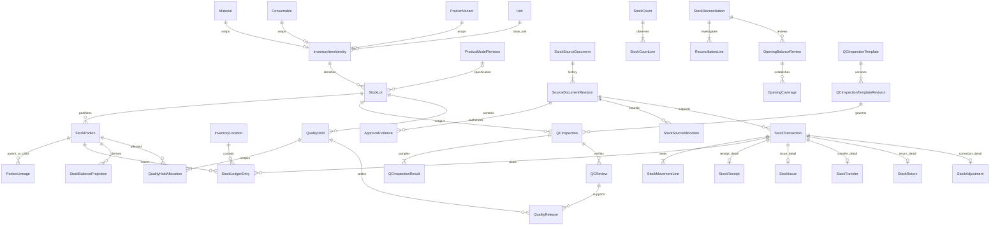

# Phase 3 PostgreSQL / Django database design

## Phase 3C-1 additive schema — 20 October 2026

Inventory0008 creates OperationRequest (sealed versioned count/request header, original/count/final links, policy and recorder), immutable OperationLine (typed identity/unit/custody/quantity/baseline/variance/original quantity), OperationDecision (actor/status/evidence/revision). Physical source uniqueness and at-most-one posted adjustment per count prevent duplication. Inventory0009 guards synthetic context, sealed payload/line/decision XIDs, legal version/state changes and atomic attributed full audit. No3B schema/guard modified.15 application migrations pending; none applied. Clean disposable migration execution is evidence, not a populated upgrade/deployment claim. [Exact report](PHASE_3C_IMPLEMENTATION_REPORT.md).

## Implemented Phase 3B additive schema — 20 October 2026

Core0003/0004 add immutable AuditEvidence, full sanitized JSON, digest, one-to-one protected event and database protection. Inventory0006 adds PostingPolicy, SourceEvent, LedgerApproval (synthetic fixture evidence), LedgerTransaction, TransactionLine, LedgerEntry, BalanceProjection and OpeningCoverage. Inventory0007 adds test-environment write guards, append-only sealing, deferred posting/audit/entry/projection checks and on-hand custody activation protection. Registration schema is not rewritten. Exact fields/constraints and migration ordering are in [Phase 3B report](PHASE_3B_IMPLEMENTATION_REPORT.md).

Numeric(20,6) is an implemented synthetic storage envelope, NOT client-approved rounding/precision. Policies explicitly narrow scale; incompatible units/excess scale fail before database numeric coercion. Missing opening coverage is unknown, not zero. BalanceProjection is a derivative, not an editable stock register. All13 application migrations remain unapplied as of this review. Clean creation was tested only in disposable PostgreSQL; populated-database rehearsal/deployment remain unauthorized and unverified. No data backfill or client quantities supplied.

## Implemented Phase 3A subset — 20 October 2026

The resumed technical request authorizes a smaller quantity-free schema than the complete proposed domain below. Actual models are Warehouse, StorageLocation, StockIdentity and WarehouseScope; exact fields/contracts are in ../../backend/docs/PHASE3A_API.md. StockIdentity directly references exactly one existing typed master plus primary Unit, explicit typed owner/evidence or UNRESOLVED, immutable generated reference/source/parent and retirement metadata. No competing item master, quantity portion, source-document workflow or ledger is introduced. Warehouse and location are separate; optional existing Department maps Stores accountability without granting scope. Global normalized configuration codes are a documented technical convention; actual location layout remains unseeded. Scope publication/revocation and all operational authority remain blocked. Proposed ledger/quality models below are still proposals, not migrations. Only inventory0001–0005 exist for the configuration subset, applied to disposable tests only.

Classification: **A — Proposed architecture** throughout except explicit I/D/S labels. [Classification convention](PHASE_3_REQUIREMENTS_TRACEABILITY.md). This is a design specification, not migrations or implementation authorization.

## Common model contract

Every proposed entity has `id UUID PK` generated server-side; no workbook row or human batch number is a PK. All FKs below are `PROTECT`, including User, and indexed; no cascade deletion of historical evidence. `V` means existing VersionedModel fields (`version positive integer`, created_at/updated_at timestamptz). Draft V objects are locked with `SELECT FOR UPDATE` and require quoted If-Match; state transitions increment version. `E` means append-only evidence with created_at timestamptz, actor User FK and request_id UUID, protected against UPDATE/DELETE/TRUNCATE by database privileges and immutable triggers. Immutable records have no mutable version; references identify exact UUID/content digest. Descriptions are text, codes varchar(100), enum labels varchar(40), digests char(64), times timestamptz unless specified. All actors come from authenticated/verified workflow context; external signers are evidence identities, not forged User records.

D04 — `Q = DecimalField(max_digits=20, decimal_places=6)` is a **candidate storage envelope** aligned with existing specification fields, not approved stock precision or rounding. Approve item/unit scale, maximum quantity and rounding before schema freeze. Posting rejects excess precision and overflow; never silently round. Quantities serialized as decimal strings. Positive/zero constraints as specified below. Nullable quantity means unknown only on observations/reviews, never posted ledger lines.

Audit every create, draft content change, submit, approve, cancel, post and disposition; record source/version, actual actor and safe summary using core audit. Business evidence has its own complete immutable payload; safe audit summaries are not its replacement. No hard deletes through APIs. Runtime may not own tables/disable triggers. Cross-row/FK invariants cannot be ordinary CHECKs: use explicit posting service plus deferred constraint triggers where stated, tested with raw SQL. All terminal evidence immutable; projections are replaceable derivatives. Full locking order is owned by [ledger rules](PHASE_3_LEDGER_AND_STOCK_RULES.md).

## Identity, custody and source entities (Phase 3A/B)

| Model / contract | Purpose and fields beyond common fields | Constraints / unique indexes | Version, immutability, transitions and concurrency |
|---|---|---|---|
| InventoryLocation / V | Tracked warehouse or sublocation: code, name varchar(240), parent self FK nullable, kind enum SITE/STORE/BIN/TRANSIT/EXTERNAL_CUSTODY, is_active bool, custody_description text; optional Area FK as a mapping only | Unique normalized code globally for present shared scope; parent != self, acyclic hierarchy validated with hierarchy lock; index parent/is_active | Active→inactive only if no unresolved custody/workflow; no identity reuse. Lock hierarchy mutations. D03 approves actual structure; no seeded machine locations |
| InventoryItemIdentity / V | Uniform stock reference: kind MATERIAL/CONSUMABLE/FG, material FK nullable, consumable FK nullable, variant ProductVariant FK nullable, base_unit Unit FK, is_active bool | CHECK exactly one matching FK; unique nonnull material, consumable and variant FKs individually; index kind | Freeze kind/master/base_unit after first lot/post. Active masters required for new use. Unit mismatch blocked; historical inactive refs readable. Future WIP identity extension blocked by D08, not invented here |
| StockLot / V | item FK, internal_code, supplier Supplier FK nullable, supplier_lot varchar(200) nullable, source SourceDocumentRevision FK, received_at nullable, manufacture_date/expiry_date date nullable, model_revision ProductModelRevision FK nullable, provenance enum VERIFIED/UNRESOLVED | Unique internal_code provisionally global (D05); supplier lot not globally unique; index item/supplier_lot, expiry_date | Internal identity/source sealed at first submitted movement. No blank-history lot manufactured from workbook names; unresolved lot cannot be usable. Lock on new portions/hold scopes/splits |
| StockPortion / E | Disjoint allocatable quantity identity within a lot: lot FK, predecessor self FK nullable, creation_transaction FK, initial_quantity Q positive, unit Unit FK | Unit=item base unit via service/deferred trigger; index lot/predecessor; portions cannot overlap by construction | Split consumes parent partition and creates child quantities exactly; no relabel to evade holds. No merge in Phase 3. Source/hold provenance inherited; locking lot and parent stock keys serializes splits |
| PortionLineage / E | parent_portion FK, child_portion FK, source_revision FK, kind SPLIT/RETURN_LINEAGE/FUTURE_TRANSFORMATION, parent_quantity Q, child_quantity Q, parent_unit/child_unit Unit FKs | Unique parent/child/source/kind; no self/cycle; quantities positive; transformation disabled in Phase 3 | Append only. Same-item same-unit split conservation checked; future transformation requires approved production adapter and cannot imply conversion equality |
| StockSourceDocument / V | Stable external/internal source identity: source_system varchar(120), kind enum GRN/REQUISITION/TRANSFER/COMPLETION/ISSUE/RETURN/COUNT/ADJUSTMENT/REVERSAL/FG_REQUISITION/SO/DISPOSITION, external_key varchar(200), current_revision FK nullable | Unique source_system/kind/external_key; nonempty fields; index kind | External evidence registry, not fake PO/job/SO model. New revision never mutates old evidence; current pointer versioned. Source conflicts require re-review |
| SourceDocumentRevision / E | document FK, revision_number int, business_at, captured_at, content JSONB schema-versioned, content_hash, evidence_refs JSONB, verified_by User FK nullable, verification_at nullable, external_approval_evidence JSONB, optional future_model_kind enum + future_object_uuid UUID + future_line_uuid UUID | Unique document/revision_number; nonempty evidence digest, known content schema; future ref fields all-or-none; no arbitrary ContentType GenericFK | Sealed content. Verification recorded in an additional ApprovalEvidence event if not available at capture (never patch sealed record). New source revision invalidates unused approvals; posted refs remain on old revision. Missing future module uses verified external reference, not fabricated UUID |
| EvidenceAttachment / E | source_revision FK, object_key text, sha256, media_type varchar(100), size_bytes bigint positive, captured_at, uploaded_by User FK, scan_status enum | Unique object_key; index sha256 (not unique: same evidence may support several records); only verified scan status usable | Upload/scan finalized before append; later quarantine/access restriction is separate event. Private storage and downloads capability checked. D15 retention/site adoption |
| ApprovalEvidence / E | source_revision FK, purpose enum BUSINESS/QUANTITY_CHECK/RECONCILIATION/OPENING/DISPOSITION, subject_uuid UUID, subject_kind enum, decision APPROVE/REJECT, maker User FK, approver User FK, policy_ref text, policy_hash, approved_content_hash, reason, external_evidence FK nullable | CHECK maker != approver; unique subject_kind/subject_uuid/purpose/approved_content_hash/approver; approved subject digest must match service validation | Never edits approval. Cancellation/supersession is new event; posting revalidates active delegated authority, scope, approved content and independence. Additional checker inequality is policy-specific, D02 |

I — Existing ProductVariant contains source sheet/row/customer/unit, packing/size/brand/pieces fields; existing Material category/family and Unit.dimension remain authoritative masters. Do not copy them into competing masters. Source snapshots retain historical meaning without changing identity.

## Ledger and workflow entities (Phase 3B/C)

| Model / contract | Purpose / fields | Constraints and indexes | Lifecycle / locking |
|---|---|---|---|
| StockTransaction / V then sealed | kind RECEIPT/ISSUE/RETURN/TRANSFER/ADJUSTMENT/OPENING/REVERSAL/QUALITY_RECLASS/SPLIT; source_revision FK; status DRAFT/SUBMITTED/AUTHORIZED/POSTED/CANCELLED; occurred_at, recorded_at, posted_at nullable; maker/recorder User FKs; content_hash; reverses self FK nullable; reason | Unique posted business source operation token, independent of actor retry key; index source/status/posted_at; posted requires posting evidence/time; no reverses=self; one full reversal per original via conditional unique reverses | Draft→submitted→authorized→posted or pre-post cancel. Any semantic edit requires new draft/review; posted never edits. Locks document aggregate then canonical stock keys. Initial full reversal only; partial correction uses separately approved compensating source, not reusable reverse flag |
| StockMovementLine / V then sealed | transaction FK, sequence int, portion FK, quantity Q positive, unit FK, from_location/to_location FK nullable, source_line_key varchar(200), authorized_quantity Q, purpose enum, original_issue_line self FK nullable | Unique transaction/sequence; at least one endpoint, different when both; unit compatibility; index original_issue_line; cumulative partial allocation <= authorized qty via locked SourceAllocation | Mutable only draft, sealed on submission; custody receipt/issue evidence and quality allocation bound by hash. Return <= original outstanding issued quantity under locks |
| StockSourceAllocation / V | source_revision FK, source_line_key, operation_kind enum, authorized_quantity Q, posted_quantity Q default0, unit FK | Unique source_revision/source_line_key/operation_kind; CHECK 0<=posted<=authorized; index source | Locks prevent multiple requests/users consuming same authorized line. Source revisions share stable source-line allocation identity when replacing content; cannot reset remaining quantity by revising source. Reallocation/reversal is explicit evidence |
| StockLedgerEntry / E | transaction FK, sequence int, portion FK, location FK, unit FK, custody_class STORE/WIP/TRANSIT/EXTERNAL_CUSTODY, quality_partition enum AWAITING/RELEASED/HELD/REJECTED/REWORK, delta Q nonzero, event_at, posted_at, source_line FK | Unique transaction/sequence; index portion/location/unit/partition/posted_at; immutable payload; no nullable quantities | Only complete posted transactions visible. Internal transfer has equal negative/positive deltas. Deferred validation enforces header posted, exact line totals, same-unit conservation, required gates and valid references. Runtime stock write API alone can post |
| StockBalanceProjection / V | portion FK, location FK, unit FK, custody_class, quality_partition, quantity Q nonnegative, last_transaction FK nullable, rebuild_generation UUID | Unique full stock key; indexes location/item via portion/lot relation; no NULL key components | Upsert absent keys under lot lock, then sorted row locks. Derived only; never independently editable. Rebuild into shadow generation and atomically compare/swap under write exclusion; no read-then-unlocked overwrite |
| StockReceipt / V | transaction OneToOne FK, receiver User FK, supplier FK nullable, Stores_evidence source FK, physical_at, measured_quantity Q, condition text, discrepancy_state enum CLEAR/PENDING/RESOLVED, checker_evidence FK nullable | Positive measured quantity; supplier required for supplier type; posted requires no unresolved discrepancy | Evidence draft→physical confirmed→ready to record→posted; PO posts. Lines support partial receipt; acceptance meaning D10 |
| StockIssue / V | transaction OneToOne FK, requisition source FK, custodian User FK, receiving_ack source FK, intended_use text, production_reference source FK nullable | Production issue requires typed authorized production/requisition evidence; quantity/ack mandatory before posting | Requested→authorized→physically acknowledged→recorded; does not record consumption |
| StockTransfer / V | transaction OneToOne FK, sending_ack/receiving_ack source FKs, actual_sent_at/received_at | Both endpoints known; no same location; same item/unit/quality obligations retained | Atomic confirmed transfer initially. If two-stage transit approved under D11, separate linked send/receive transactions with outstanding transit and discrepancy hold; never pretend asynchronous receipt occurred |
| StockReturn / V | transaction OneToOne FK, return_kind PRODUCTION/SUPPLIER/CUSTOMER, original_source source FK, original_issue FK nullable, receiver User FK, condition text | Original references required according to kind; bounded allocation; quality decision required before returned-unknown stock usable | Physical confirmed→QC disposition where needed→recorded; legitimate return does not delete original issue. Customer/supplier commercial execution deferred |
| StockAdjustment / V | transaction OneToOne FK, reconciliation FK, investigation source FK, approval FK, reason_code, supporting_evidence source FK | No unapproved free quantity; target exact key; adjustment delta may be ±, nonzero; independent approval required | Proposed→investigated→authorized→posted. Never automatic from count difference; source revision and locked current quantity rechecked |
| StockCount / V | location FK, cutoff_at, ledger_snapshot_hash, status DRAFT/COUNTING/SUBMITTED/REVIEWED/CANCELLED, assigned_by User FK, movement_control enum FROZEN/BRIDGED | Unique count code; index location/cutoff; no balance mutation during count | Start captures committed ledger snapshot; counters submit immutable lines; movements frozen or explicitly bridged under D12; do not compare count to a changing unbounded total |
| StockCountLine / E | count FK, item FK, lot/portion FK nullable only if identity unresolved, unit FK, observed_quantity Q nullable, observation_state KNOWN/UNKNOWN/DISPUTED, counter User FK, counted_at, evidence FK | CHECK known iff qty present and >=0; unique count/line_number; duplicate actual key flagged rather than summed | Correct count by new superseding line, preserve original; unknown identities enter reconciliation, not posting |
| StockReconciliation / V | count FK nullable, cutoff_at, reviewed_by User FK nullable, status OPEN/INVESTIGATING/READY/APPROVED/CLOSED, evidence source FK, completeness enum COMPLETE/INCOMPLETE | Independent reviewer vs custody/entry set under D02; index status/cutoff | Close only all lines explained or separately approved unresolved exception; no implied adjustment. Lock lines/source allocations on approval |
| ReconciliationLine / V then sealed | reconciliation FK, item/location/unit/portion refs, system_quantity Q nullable, physical_quantity Q nullable, variance Q nullable, finding text, resolution source FK nullable, adjustment FK nullable | Unique reconciliation/line_number; variance only when comparable known quantities; unit match; index unresolved status | Seal reviewed evidence. Follow-up new revision; adjustment link cannot stand in for investigation |
| OpeningBalanceReview / V | reconciliation FK, cutoff_at, source_manifest_hash, review_hash, status DRAFT/REVIEWED/APPROVED/POSTED/SUPERSEDED, maker/reviewer User FKs, approval FK nullable, transaction FK nullable | Unique approved opening scope/cutoff managed by OpeningCoverage; no numeric default; exact line digest | Independent approval of each reconciled scope; posting consumes approved plan exactly once. Source drift requires fresh review. No opening imported by master import |
| OpeningCoverage / V | item/location/unit refs, cutoff_at, status UNKNOWN/DISPUTED/RECONCILED, approved_quantity Q nullable, opening_review FK nullable | Unique item/location/unit/cutoff; CHECK reconciled iff approved qty present/nonnegative and review present; index status | No UNKNOWN→0 shortcut; approval establishes starting coverage, ledger OPENING records known initial quantity (zero approval can have no nonzero ledger line but retained approval). Scope overlap prevented by locked scope policy |

## Quality entities (Phase 3D, with enforcement hooks in 3B)

| Model / contract | Purpose and typed fields | Constraints / indexes | Lifecycle / concurrency |
|---|---|---|---|
| QCInspectionTemplate / V | code, name, current_revision FK nullable, is_active | Unique code | No in-place edits to published revisions; current pointer versioned; publication authority D02/D09 |
| QCInspectionTemplateRevision / V then E | template FK, number int, approved_spec_reference source FK, criteria JSONB schema-versioned (question ID/type/unit/conditional applicability/expected polarity/approved limit refs), sampling_reference source FK, effective_from, approved_by User FK nullable, status DRAFT/PUBLISHED/RETIRED | Unique template/number; publish requires authoritative requirements and independent approval where policy requires; no arbitrary expressions/code | Draft→publish seals content; retirement separate event/pointer, old inspections unchanged; lock template for next number |
| QCInspection / V then sealed | template_revision FK, lot FK, source_revision FK, operator User FK nullable, inspector User FK, prior_inspection self FK nullable, presented_quantity Q, inspected_quantity Q, unit FK, period_from/to nullable, status DRAFT/SUBMITTED/REVIEWED, off_shift bool, required_gate_hash | CHECK 0<=inspected<=presented; period endpoints both present/ordered; no self prior; index lot/status/period | Submitted results immutable. Reinspection new record, independent of production execution; QC review actor capability and independence checked. No automatic supervisor tier |
| QCInspectionResult / E | inspection FK, question_key, sample_key, value JSONB tagged union DECIMAL/BOOLEAN/TEXT/NA, unit FK nullable, requirement_reference source FK, evidence FK nullable, recorded_by User FK, performed_at | Unique inspection/question/sample; NA needs reason/applicability; numeric value schema exact decimal; no universal Yes=pass | Insert sealed snapshot on submission; corrections new inspection/supplement event. Approved limits external to generic code |
| QCReview / E | inspection FK, reviewer User FK, production_actor User FK nullable, decision PASS/FAIL/INCOMPLETE, findings text, evidence source FK | Reviewer != production executor; inspector/reviewer distinction only if actual policy requires another QC actor; index inspection/created_at | Independent QC of operator work is mandatory; requiring two QC staff for all reviews is not established by SOP. Missing evidence cannot pass |
| QualityHold / E | lot FK, reason, initiated_by User FK, scope_kind QUANTITY/LOT/PERIOD, quantity Q nullable, unit FK, period_from/to nullable, source_revision FK, nonconformance_reference source FK nullable | Quantity positive for quantity scope; valid period bounds; index lot/created_at | Immediate hold by authorized QC or PM. Active state derived from hold/release events; no mutable boolean that can erase history. Lock lot before expanding scope |
| QualityHoldAllocation / E | hold FK, portion FK, allocated_quantity Q, location_at_identification FK, allocation_event kind APPLY/RELEASE, release FK nullable | Quantity positive; release references same hold/portion; cumulative release <= applied; unique event allocation ordinal | Overlapping holds are independent gate memberships, not summed held qty. Disjoint portions avoid double count; splits inherit memberships; future receipts under open scope rechecked |
| QualityRelease / E | inspection FK, review FK, hold FK nullable, portion FK, quantity Q positive, unit FK, purpose USE/TRANSFER_AS_CONFORMING/DISPATCH, released_by User FK, released_at, concession source FK nullable, approved_scope_hash | Unique release business operation token; index portion/hold/purpose; cannot exceed eligible inspected/allocated quantity cumulatively | Lock lot/portion/gates; settle only named requirement/hold, not all gates. New hold supersedes availability, not history. Release does not post physical IN; quality partition reclass is ledger-derived |

## Deferred named entities

A/D08 — `ProductionWIPReference` is initially the typed SourceDocumentRevision contract, not a production-order model. A later production app may introduce UUID work order/run/operation FKs after approved routing and WIP scope. `MaterialConsumption` is deferred: future E fields would be issue_line FK, production_run FK, portion FK, quantity Q positive, unit FK, occurred_at, authorization/source; unique source event; cumulative consumed+returned+waste cannot exceed issued. It requires actual usage evidence and separate waste/reject transformations. No consumption from recipe estimates.

A — Reservations, production output transformation tables, NCR/CAPA execution, purchase/SO/invoice/dispatch/recycling/maintenance execution, valuation/cost layers and automatic unit conversions are deferred. Inspection can link verified external NCR/disposition evidence without implementing a CAPA lifecycle. Waste/scrap item-master extension and ownership dimension must be decided before schema freeze if in Phase 3 (D03/D08); do not force all categories into existing Material without approved mapping.

## ER diagram

## Migration design and operational boundary

A — Future additive migrations only: identities/source evidence first; transaction/projection/ledger constraints and immutable guards next; reconciliation and opening evidence next; QC templates/gates plus ledger availability integration before operational posting; query indexes after measured workloads. Dependency graph uses existing masters/accounts/specifications/core leaf migrations, not new historical edits. Require upgrade rehearsal from existing Phase 2 and Phase 2.1 states in disposable PostgreSQL, fresh install, restricted runtime-role tests and restore rehearsal. No data migration seeds roles, openings or lots. All migration names remain future proposals. No migration generated or applied in this task.

## Phase 3D synthetic implementation — 20 October 2026

Implemented inventory0012_qc_foundation,0013_qc_guards,0014_qc_action_evidence add nine protected UUID QC evidence tables, typed plan item checks, unique plan revisions/reviews/authorization-posting linkage, positive quantities and append-only synthetic/audit/conservation guards. QUALITY extends the transaction kind through a new migration; no prior applied migration is edited. No StockPortion/REJECTED ledger bucket/split engine is added. Populated upgrades and production ACL rollout remain unverified and unauthorized.
